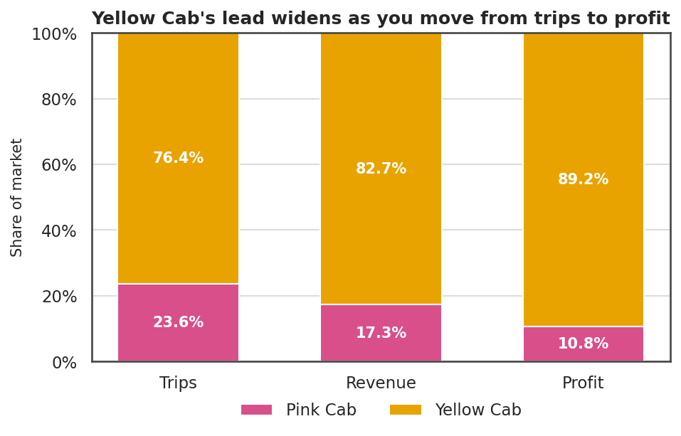

# Cab investment analysis

Which of two US cab operators should a private investor acquire? This data analytics project works through 359,392 trips from 2016 to 2018 to provide detailed analysis and business recommendations

> The details are contained in **[REPORT.md](REPORT.md)**.



## Client Brief

XYZ is a private firm planning to enter the US cab market by acquiring an existing operator. Two candidates: Pink Cab and Yellow Cab. They supplied four files covering three years of trips, customers and city populations, and asked which company to buy.

## Analysis

Yellow Cab runs 76% of the trips and keeps 89% of the profit. That gap is the whole finding, and most of the work goes into testing whether it holds up.

- **$44.0m profit against $5.31m**, on a 35.0% margin against 20.2%
- **Yellow Cab out-earns Pink Cab in all 19 cities**, and 60% of its own profit comes from New York alone
- **13.1% of Pink Cab trips lose money**, against 5.0% of Yellow Cab's
- **Rider demographics are identical** between the two, so there is no segment to buy
- **Both companies lost about a fifth of their profit in 2018** while volumes barely moved
- **Controlling for city, distance, timing and rider**, the Yellow Cab badge is still worth about $50 per trip

## Repository layout

```
.
├── README.md                    you are here
├── REPORT.md                    the written analysis and recommendation
├── run_analysis.py              regenerates every figure and table
├── requirements.txt
├── data/raw/                    the four source CSVs
├── notebooks/
│   └── cab_investment_analysis.ipynb    the working analysis, start to finish
├── src/
│   ├── data.py                  loading, cleaning, joining, join audit
│   ├── analysis.py              descriptive tables and hypothesis tests
│   ├── model.py                 profit model, time split, company effect
│   └── plots.py                 the twelve charts
└── outputs/
    ├── figures/                 PNGs used in the report
    └── tables/                  CSV and JSON behind every number quoted
```

The jupyter notebook tells the story. The modules hold the logic, so the notebook stays readable and every number in the report can be regenerated without re-running charts by hand.

## Running it

Built and tested on Python with the versions pinned in `requirements.txt`.

```bash
pip install -r requirements.txt
python run_analysis.py
```

Takes two to three minutes, mostly the gradient boosting fit and the permutation importance. It writes to `outputs/figures/` and `outputs/tables/`.

To work through the notebook instead:

```bash
jupyter lab notebooks/cab_investment_analysis.ipynb
```

It runs from either the project root or `notebooks/`.

## Data

The four files in `data/raw/` are the G2M cab investment case study dataset: trip records, transaction-to-customer links, customer demographics, and city populations. Column meanings are documented in `src/data.py`.

The customer attributes look generated rather than observed, which is noted in the report. No conclusion depends on them.

## Licence

MIT. See [LICENSE](LICENSE).
