# Cab market entry: which company should XYZ acquire?

**Analyst:** Chigozie Edwin Nlemeke
**Data:** 359,392 completed trips, January 2016 to December 2018, 19 US cities
**Question:** XYZ wants to enter the US cab market by buying one of two operators. Which one?

---

## Recommendation

**Buy Yellow Cab**, and price the deal off 2018 rather than the three-year average.

Yellow Cab earned $44.0m of trip profit over the three years against Pink Cab's $5.3m, on a 35.0% margin against 20.2%. It out-earns Pink Cab in all 19 cities. It keeps its riders where Pink Cab does not. And once you control for the cities each one operates in, how far their trips run, when they run and who is riding, Yellow Cab still earns about $50 more per trip at the median. The advantage survives the controls, so it belongs to the company rather than to its postcodes.

Three conditions attach to that recommendation, and they are in the risks section at the end. The largest is that 60% of Yellow Cab's profit comes from New York.

---

## 1. What the data is, and what it is not

Four files were supplied:

| File | Rows | What it holds |
|---|---|---|
| `Cab_Data.csv` | 359,392 | One row per completed trip: company, city, distance, fare, cost |
| `Transaction_ID.csv` | 440,098 | Links a trip to a customer, plus payment mode |
| `Customer_ID.csv` | 49,171 | Gender, age, monthly income |
| `City.csv` | 20 | Population and existing cab users per city |

Four things came out of the join check and they shape everything after it.

**80,706 transactions have no trip attached.** The customer IDs resolve and the payment mode is filled in, but `Cab_Data.csv` has no matching record. The brief offers no explanation. The most likely readings are that these belong to operators outside the two being compared, or to cancelled trips. Neither can contribute to a profit comparison, so the analysis uses an inner join on the trip file and drops them deliberately rather than silently.

**San Francisco is in `City.csv` with no trips in the data.** Neither company operates there, so it falls out of every city breakdown and 19 cities remain.

**24,819 trips lost money, 6.9% of all trips.** These are genuine records, not data errors, and they stay in. Which company absorbs them turns out to matter.

**Everything else is clean.** No missing values, no duplicate transaction IDs, every customer ID resolves to a demographic record.

One limitation to state up front. The files contain no fleet size, driver count, fixed cost, licensing or capital structure. "Profit" throughout this report means fare charged minus the cost booked against that trip. It is trip contribution, not company profit, and it cannot be turned into a valuation without the cost base.

---

## 2. The headline comparison

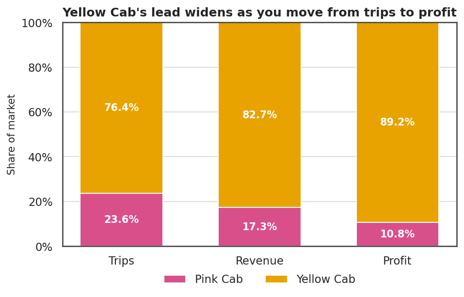

| | Pink Cab | Yellow Cab |
|---|---:|---:|
| Trips | 84,711 | 274,681 |
| Customers | 32,330 | 39,896 |
| Revenue | $26.3m | $125.9m |
| Profit | $5.31m | $44.02m |
| Margin | 20.2% | 35.0% |
| Profit per trip | $62.65 | $160.26 |
| Median profit per trip | $41.50 | $102.00 |
| Average distance | 22.56 km | 22.57 km |
| Price per km | $13.78 | $20.30 |
| Cost per km | $11.00 | $13.20 |
| Trips run at a loss | 13.1% | 5.0% |

Yellow Cab runs 76.4% of the trips, takes 82.7% of the revenue and keeps 89.2% of the profit. The lead grows at every step, which means the volume share understates the economic gap.

The reason is pricing, not distance. Both companies average 22.6 km per trip, close enough to identical that the difference is noise. Yellow Cab charges $20.30 per km against Pink Cab's $13.78, a 47% premium, while its cost per km is only $2.20 higher. It is charging more than the extra cost explains, and riders are paying it.

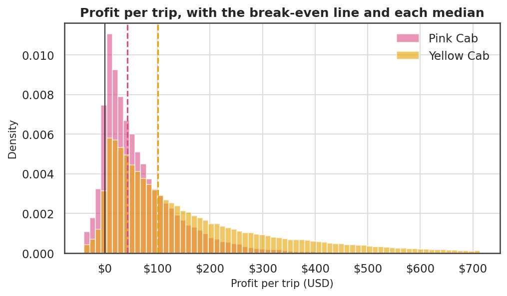

The left tail is the part that should worry a buyer looking at Pink Cab. One trip in eight loses money, three years running, against one in twenty for Yellow Cab. That is a structural pricing problem, not a bad month.

---

## 3. Both companies went backwards in 2018

| Company | Year | Trips | Profit | Margin | Profit change |
|---|---:|---:|---:|---:|---:|
| Pink Cab | 2016 | 25,080 | $1.71m | 21.7% | |
| Pink Cab | 2017 | 30,321 | $2.03m | 21.2% | +18.7% |
| Pink Cab | 2018 | 29,310 | $1.56m | 17.6% | **-23.3%** |
| Yellow Cab | 2016 | 82,239 | $13.93m | 36.2% | |
| Yellow Cab | 2017 | 98,189 | $16.58m | 36.2% | +19.0% |
| Yellow Cab | 2018 | 94,253 | $13.52m | 32.5% | **-18.5%** |

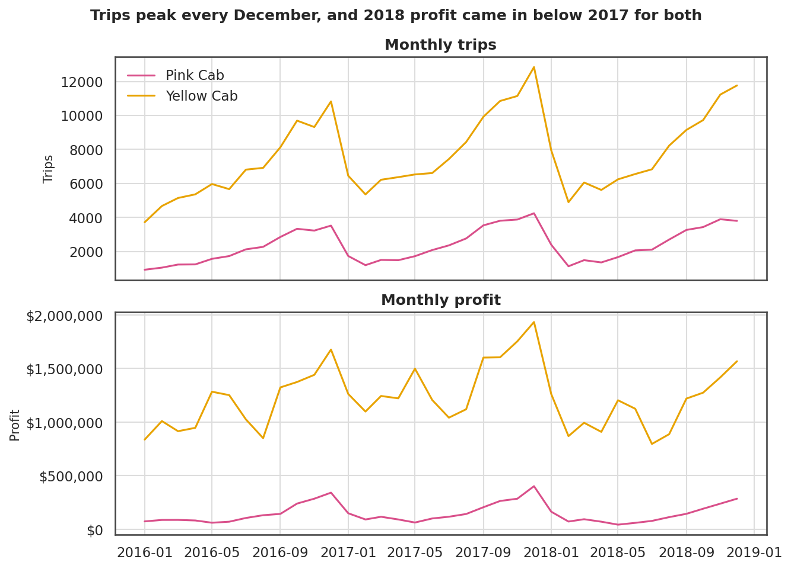

This is the single most important trend in the data and it is easy to miss if you only look at three-year totals. Both companies grew strongly into 2017, then lost roughly a fifth of their profit in 2018 while trip volumes barely moved, down 3.3% and 4.0%.

Volume holding up while margin falls points at price pressure rather than lost riders. The data contains no competitor information, so the cause cannot be identified here. The timing is consistent with ride-hailing competition, but that is an inference from outside the data, not a finding in it.

For the deal, the implication is concrete: underwrite on 2018 economics. The three-year average flatters both businesses.

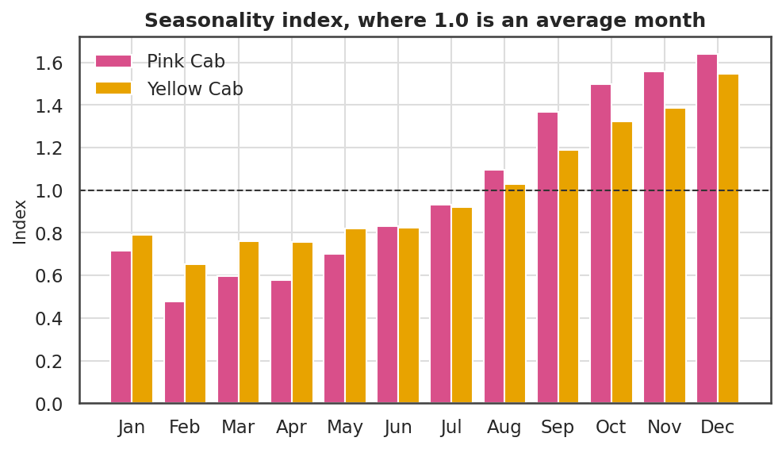

Seasonality is strong and almost identically shaped for both companies. December runs 55 to 64% above an average month, February 35 to 50% below. Three years is a thin base for a seasonal estimate, so treat the index as indicative, but the shape repeats in all three years and is enough to plan working capital and driver supply around.

---

## 4. Where the money actually is

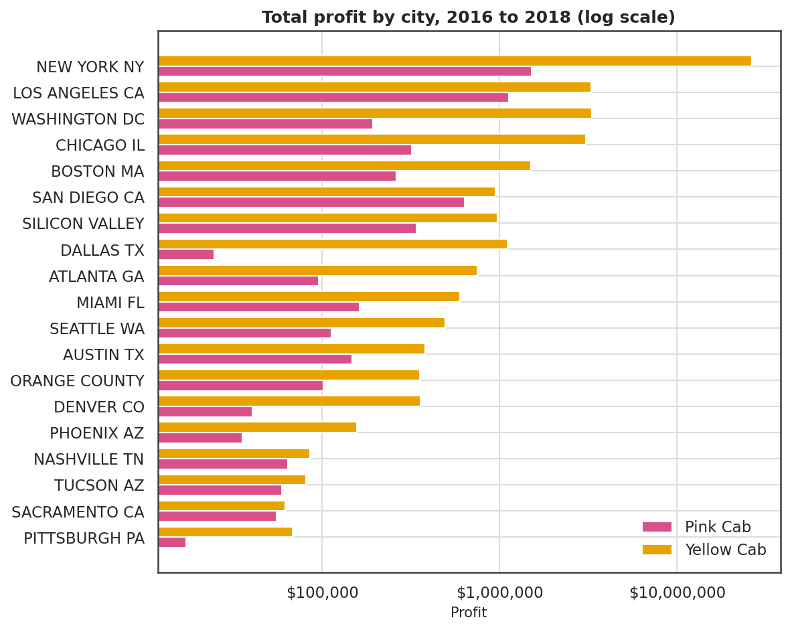

Total profit, 2016 to 2018:

| City | Pink Cab | Yellow Cab |
|---|---:|---:|
| New York NY | $1.51m | **$26.45m** |
| Los Angeles CA | $1.13m | $3.29m |
| Washington DC | $0.19m | $3.30m |
| Chicago IL | $0.32m | $3.07m |
| Boston MA | $0.26m | $1.51m |
| San Diego CA | $0.64m | $0.95m |
| Silicon Valley | $0.34m | $0.98m |
| Dallas TX | $0.02m | $1.10m |
| *Remaining 11 cities* | $0.89m | $3.38m |

**New York is the Yellow Cab story.** $26.45m of profit, 60.1% of the company's three-year total, at a 50.9% margin against 40.8% in Silicon Valley, the next best. No other city is remotely comparable.

That concentration cuts both ways. It is the reason Yellow Cab's numbers look as good as they do, and it is the largest risk in the acquisition. One regulatory change, one licensing decision or one aggressive competitor in a single city could remove more than half the earnings.

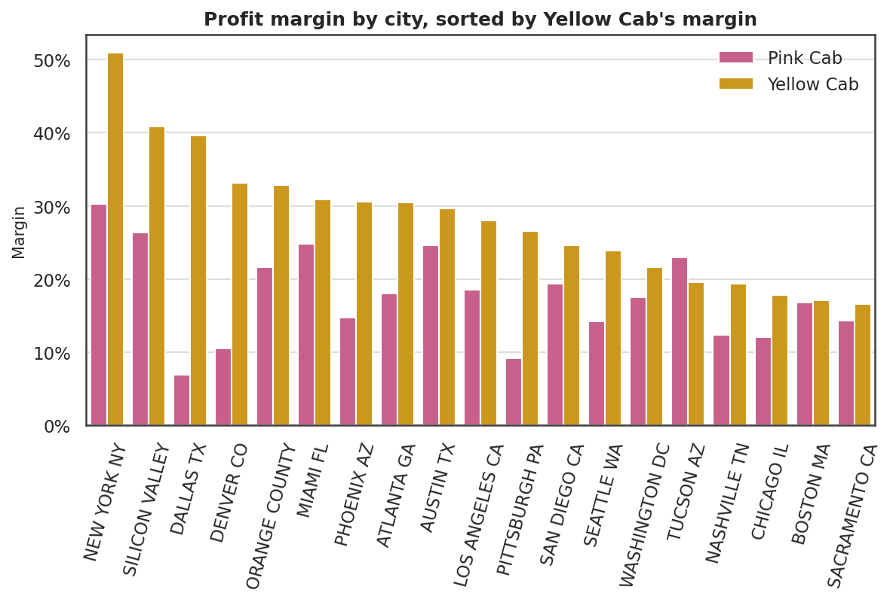

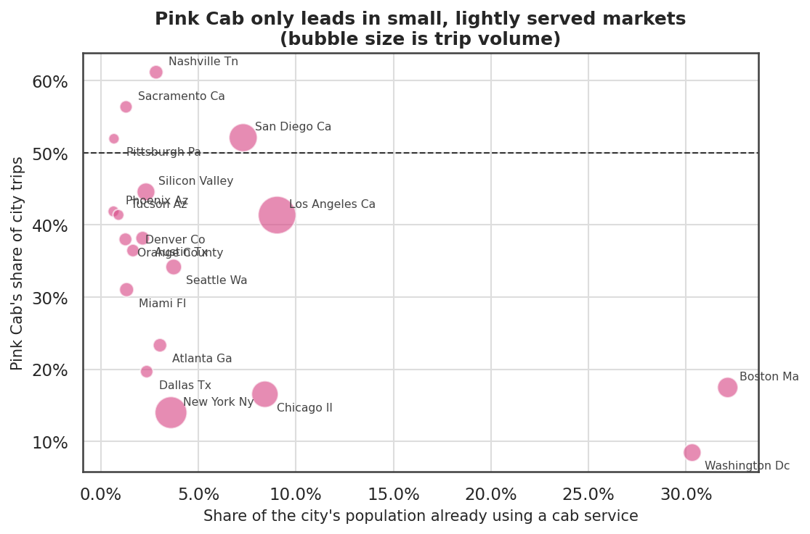

Pink Cab leads on trip share in four of nineteen cities: Nashville (61.2%), Sacramento (56.4%), San Diego (52.1%) and Pittsburgh (51.9%). Three of those four are small markets. Added together, those four cities produce $0.77m of Pink Cab profit, less than Yellow Cab earns in Dallas alone ($1.10m).

Tucson is the only city anywhere in the data where Pink Cab's profit per trip beats Yellow Cab's, $74.20 against $71.53, on 799 trips. That is too small a base to build an investment case on.

---

## 5. The riders are the same. The loyalty is not.

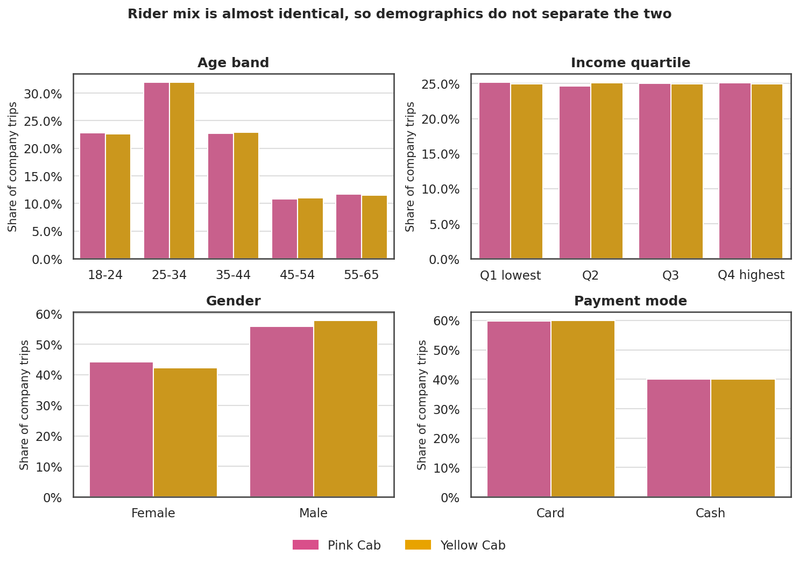

A reasonable expectation going in is that the two companies serve different customers, and that one of them owns a segment worth buying. They do not.

Age bands, income quartiles, gender split and payment mode land within a couple of percentage points of each other. Card and cash split 60/40 for both. Income is uniform across all four quartiles for both companies, which is itself a hint that the customer attributes may have been generated rather than observed. Whatever the reason, no rider attribute in this data separates the two businesses, and no conclusion in this report rests on one.

Loyalty is a different matter.

| | Pink Cab | Yellow Cab |
|---|---:|---:|
| Customers | 32,330 | 39,896 |
| Took more than one trip | 55.7% | 69.8% |
| Average trips per customer | 2.62 | 6.88 |
| Share of trips from repeat riders | 83.1% | 95.6% |

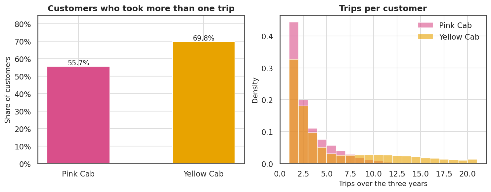

Yellow Cab's riders come back, and they come back more often. 95.6% of its volume comes from customers on their second trip or later, against 83.1% for Pink Cab.

The overlap figure is the awkward one. 26,078 customers used both companies. That is 80.7% of Pink Cab's entire customer base, against 65.4% of Yellow Cab's. Pink Cab is mostly serving people who also ride Yellow Cab, which makes it the second choice inside its own book.

---

## 6. Testing the differences

Three hundred and fifty thousand rows will make almost any difference statistically significant, so each test below is reported with an effect size next to it.

| Test | Result | Effect size | Reading |
|---|---|---|---|
| Profit per trip, Yellow vs Pink | Welch t = 231.0, p < 0.001 | Cohen's d = 0.63 | Real and moderate. $97.61 per trip |
| Same, distribution-free check | Mann-Whitney, p < 0.001 | | Holds without normality assumptions |
| Mean trip margin | Welch t = 199.1, p < 0.001 | +12.8 points | Holds after stripping out trip length |
| Company vs gender | Chi-square, p < 0.0001 | Cramer's V = 0.017 | Detectable, meaningless. Ignore |
| Company vs payment mode | Chi-square, p = 0.54 | Cramer's V = 0.001 | No association |
| Profit per trip across cities | ANOVA, p < 0.001 for both | | City is a real driver. Must be controlled for |

The gender row is worth pausing on. The p-value is below 0.0001 and the association is worth nothing: Cramer's V of 0.017 on a scale where 1.0 is a perfect relationship. At this sample size, significance alone is not evidence of anything a business should act on. The effect size is what decides it.

Note on margin: the 12.8 point gap is the average of per-trip margins, which weights a $20 trip the same as a $500 one. The aggregate margin, total profit over total revenue, is 35.0% against 20.2%. Both measures point the same way, and they are reported separately rather than blended.

---

## 7. How much of the gap is the company itself?

The descriptive work establishes that Yellow Cab earns more per trip. It does not establish why. Yellow Cab runs most of New York, and New York is the most profitable market in the data, so part of the gap could simply be where it operates.

A model separates the two. It predicts profit on a single trip from what is knowable before the meter runs: distance, company, city, city population, cab adoption in that city, month, weekday, payment mode, and the rider's age, gender and income.

Two design decisions matter.

**No leakage.** Profit is fare minus cost, so neither column, nor margin or price per km, can be a feature. Including any of them would produce a perfect model that explains nothing.

**The split is by time, not at random.** 2016 and 2017 train, 2018 is held out entirely. A random split would leak the 2018 margin environment into training and flatter the result, and 2018 is exactly the year a buyer needs the model to handle.

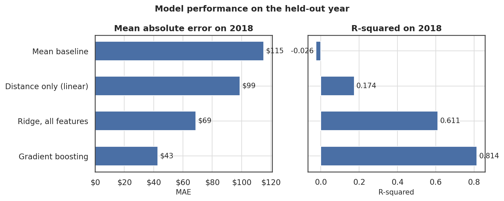

| Model | Test MAE | Test RMSE | Test R² | Bias on 2018 |
|---|---:|---:|---:|---:|
| Mean baseline | $115.14 | $146.52 | -0.026 | +$23.21 |
| Distance only, linear | $98.80 | $131.47 | 0.174 | +$23.04 |
| Ridge, all features | $68.67 | $90.27 | 0.611 | +$21.20 |
| **Gradient boosting** | **$42.82** | **$62.37** | **0.814** | **+$20.92** |

Gradient boosting predicts trip profit within $42.82 on average on a year it never saw, against $98.80 for a distance-only baseline. The added complexity earns its place.

The bias column deserves as much attention as the accuracy. Every model overpredicts 2018 profit, the best one by $20.92 per trip. That is the margin squeeze from section 3 showing up independently: a model trained on 2016 and 2017 expects trips to be more profitable than they turned out to be. It is a second, model-based reason to underwrite on 2018.

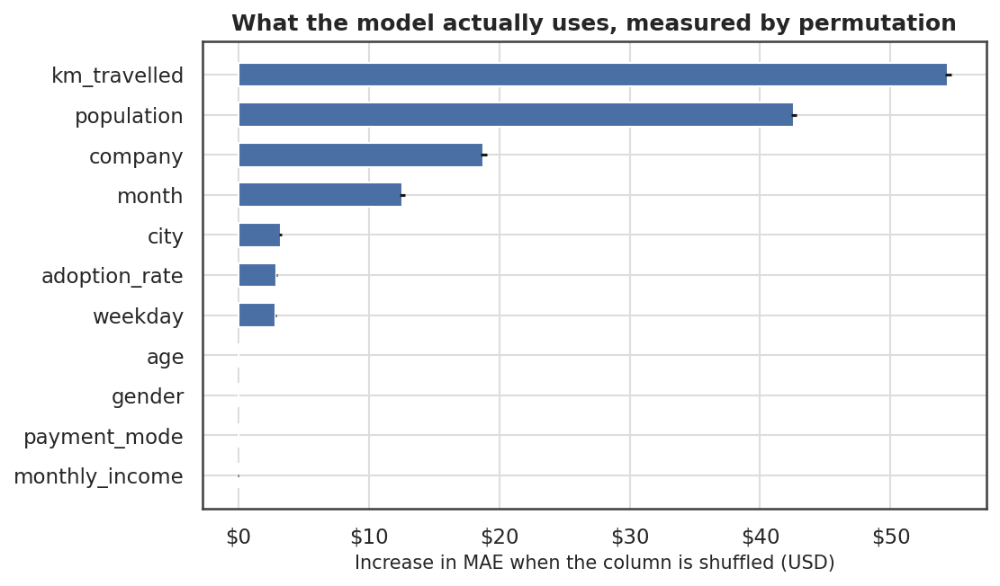

Permutation importance, measured as the increase in error when a column is shuffled on the held-out year:

| Feature | MAE increase |
|---|---:|
| Distance travelled | $54.40 |
| City population | $42.57 |
| **Company** | **$18.81** |
| Month | $12.60 |
| City | $3.25 |
| Cab adoption rate | $2.95 |
| Weekday | $2.88 |
| Age, gender, payment mode, income | $0.00 or below |

Distance dominates, as expected. City population ranking second and city name fifth looks odd until you see they encode the same thing: the model can split a continuous population variable more finely than nineteen one-hot city flags, so population absorbs most of the city signal and leaves the city column with the remainder. Read together, the city effect is worth about $46.

Rider attributes contribute nothing. Age, gender, income and payment mode all sit at or below zero, meaning shuffling them does not hurt the model. This independently confirms the descriptive finding in section 5.

**The company effect.** To isolate it, every held-out 2018 trip was scored twice: once as it happened, once with the company swapped and everything else held fixed.

| Trips run by | Median uplift from being Yellow Cab | Mean uplift |
|---|---:|---:|
| Pink Cab (29,310 trips) | $47.28 | $76.69 |
| Yellow Cab (94,253 trips) | $52.63 | $96.75 |

Holding city, distance, timing and rider constant, the same trip is worth roughly $50 more at the median under the Yellow Cab badge. The mean runs far higher because New York trips pull it up.

So the raw $97.61 gap is partly mix. Correct for everything observable and about half of it survives, attributable to the company itself: its pricing power, its position in its markets, or whatever sits behind those.

---

## 8. Recommendation and conditions

**Acquire Yellow Cab.**

| Criterion | Pink Cab | Yellow Cab | Winner |
|---|---|---|---|
| Three-year profit | $5.31m | $44.02m | Yellow |
| Margin | 20.2% | 35.0% | Yellow |
| Profit per trip | $62.65 | $160.26 | Yellow |
| Loss-making trips | 13.1% | 5.0% | Yellow |
| Repeat customer rate | 55.7% | 69.8% | Yellow |
| Trips per customer | 2.62 | 6.88 | Yellow |
| Cities led on profit | 0 of 19 | 19 of 19 | Yellow |
| Company effect, controlled | baseline | +$50 per trip | Yellow |
| Revenue concentration | more even | 60% in New York | **Pink** |
| 2018 profit decline | -23.3% | -18.5% | Yellow |

Yellow Cab wins on every measure except one, and it wins the comparable ones by wide margins rather than narrow ones.

Pink Cab is not a cheaper way to the same outcome. It loses money on one trip in eight, it leads in four small cities, and 80.7% of its customers already ride with Yellow Cab. It is the second choice inside its own customer base.

### Three conditions

**Price the New York concentration into the deal.** 60.1% of Yellow Cab's profit comes from one city at a margin no other city approaches. Stress-test the valuation against losing a third of New York's contribution rather than averaging the risk away across 19 cities.

**Underwrite on 2018, not the three-year average.** Both companies lost roughly a fifth of their profit in 2018 while volumes held. The model confirms it independently by overpredicting the held-out year by $20.92 per trip. Using 2016 and 2017 economics would overstate the business by a wide margin.

**Do not budget for segmentation gains.** Age, income, gender and payment mode are flat across both companies and contribute nothing to the model. The levers here are pricing, city mix and retention. Anyone promising value from better customer targeting is promising something this data does not support.

---

## 9. What this analysis cannot tell you

Stated plainly, because the recommendation should be read with these in view.

**No cost base.** No fleet size, driver count, fixed cost, licensing or capital structure. "Profit" is trip contribution. It cannot become a valuation without the cost base, and a company with better trip contribution can still be the worse business if its fixed costs are higher.

**No competitor data.** The 2018 margin compression is clearly visible and its cause is not identifiable from these files. Whether it continued into 2019 is the single most valuable unknown in the deal.

**The rider attributes look generated.** Income is uniform across quartiles, and age, gender and payment mode are near-identical between two companies that differ in every economic respect. This is the pattern of simulated data. Nothing in the recommendation depends on those columns, which is deliberate.

**Three years is short for seasonality.** The December peak repeats in all three years, so the shape is probably real, but the magnitudes carry wide uncertainty.

**80,706 unmatched transactions.** Excluded for good reason, but if they turn out to be cancelled trips rather than other operators, cancellation rates could differ between the two companies and that would be material.

A confirmatory diligence pass needs the cost base, at least two more years of trips, and an explanation for those unmatched transactions.

---

## Reproducing this

```bash
pip install -r requirements.txt
python run_analysis.py
```

That regenerates every figure and table quoted above into `outputs/`. The working notebook is `notebooks/cab_investment_analysis.ipynb`.
